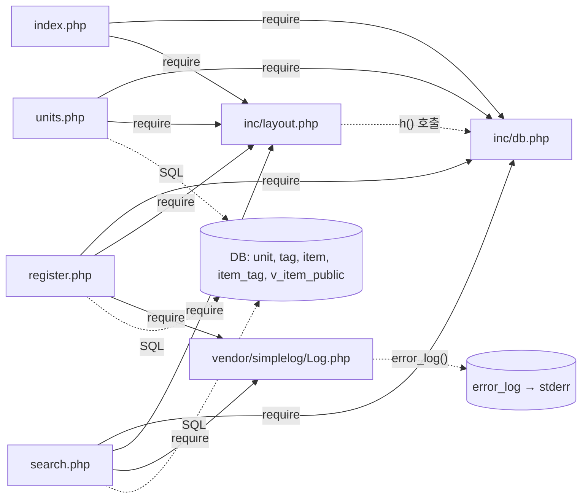

# legacy/item-bank-php 아키텍처

> 근거 표기의 파일 경로는 `legacy/item-bank-php/` 기준이다. 분석 범위는 진입점과 의존 관계까지이며, 데이터 흐름과 비즈니스 규칙은 아직 분석하지 않았다.

## 모듈 개요

- 문항 은행 레거시 화면이다. 문항 검색, 문항 등록, 단원 목록의 세 화면으로 구성된다 (`index.php:9-11`).
- 실행 환경은 PHP 7.4 + Apache이고 DB 접근에는 mysqli를 쓴다 (`Dockerfile:1`, `Dockerfile:3`).
- 프레임워크나 라우터 없이 PHP 파일 하나가 URL 하나에 대응한다 (`Dockerfile:14`).
- 공통 코드는 `inc/`(DB 연결·이스케이프, 레이아웃)와 `vendor/simplelog`(로그)에 있다.
- 전체 8개 파일, 1,120줄이다. 이 중 `search.php`가 731줄을 차지한다.

## 폴더 구조

```
legacy/item-bank-php/
├── Dockerfile                 16줄  실행 환경 (php:7.4-apache, mysqli)
├── index.php                  14줄  홈 메뉴
├── search.php                731줄  문항 검색 (함수 4개)
├── register.php              177줄  문항 등록 (함수 없음)
├── units.php                  48줄  단원 목록 (함수 없음)
├── inc/
│   ├── db.php                 37줄  db_connect(), h()
│   └── layout.php             43줄  render_header(), render_footer()
└── vendor/
    └── simplelog/
        └── Log.php            54줄  외부 라이브러리 (SimpleLog\Log)
```

## 진입점

`Dockerfile:14`에서 모듈 전체를 웹 루트(`/var/www/html/`)로 복사하므로 PHP 파일 하나가 URL 하나에 대응한다. `mod_rewrite`는 켜져 있지만(`Dockerfile:4`) 모듈 안에 `.htaccess`는 없다.

| URL / 화면 | 처음 실행되는 파일 | 주요 호출 (근거) |
|---|---|---|
| `/index.php`, 홈 메뉴 | `index.php` | `render_header('홈')` `index.php:5`, `render_footer()` `index.php:14`. `db.php`를 포함하지만(`index.php:2`) DB 호출은 없다. |
| `/search.php`, 문항 검색 (GET) | `search.php` | `render_header` `:709` → `db_connect` `:713` → `buildSearchQuery($_GET, $conn)` `:722` → `renderSearchForm` `:723` → `runSearchQuery` `:724` → `renderResultTable` `:725` → `render_footer` `:731` |
| `/register.php` GET, 등록 폼 | `register.php` | `db_connect` `:17` → 단원·태그 목록 조회 `:27`, `:34` → `render_header` `:127` → 폼 출력 `:141-175` → `render_footer` `:177` |
| `/register.php` POST, 등록 처리 | `register.php` | 분기 `:40` → 검증 `:49-81` → 트랜잭션 INSERT `:85-114` → `Log::info` `:115`, 실패하면 `Log::error` `:121` |
| `/units.php`, 단원 목록 | `units.php` | `render_header` `:5` → `db_connect` `:8` → `$conn->query` `:20` → `render_footer` `:48` |

`inc/*.php`와 `vendor/simplelog/Log.php`도 웹 루트 안에 있어 URL로 직접 열 수 있다(`Dockerfile:14`). 다만 함수와 클래스를 정의만 하고 아무것도 출력하지 않으므로 화면 진입점은 아니다.

## 의존 관계

### 흐름도



실선은 `require_once`에 의한 포함이고, 점선은 파일 간 함수 호출 또는 DB 접근이다.

### 파일 포함 (require_once)

| 호출 방향 | 근거 |
|---|---|
| `index.php` → `inc/db.php` | `index.php:2` |
| `index.php` → `inc/layout.php` | `index.php:3` |
| `units.php` → `inc/db.php` | `units.php:2` |
| `units.php` → `inc/layout.php` | `units.php:3` |
| `register.php` → `inc/db.php` | `register.php:2` |
| `register.php` → `inc/layout.php` | `register.php:3` |
| `register.php` → `vendor/simplelog/Log.php` | `register.php:4` |
| `search.php` → `inc/db.php` | `search.php:20` |
| `search.php` → `inc/layout.php` | `search.php:21` |
| `search.php` → `vendor/simplelog/Log.php` | `search.php:22` |

### 파일 간 함수 호출

| 호출 방향 | 호출 대상 | 근거 |
|---|---|---|
| `inc/layout.php` → `inc/db.php` | `h()` | `layout.php:17`, `layout.php:33` |
| `index.php` → `inc/layout.php` | `render_header`, `render_footer` | `index.php:5`, `index.php:14` |
| `units.php` → `inc/layout.php` | `render_header`, `render_footer` | `units.php:5`, `units.php:48` |
| `register.php` → `inc/layout.php` | `render_header`, `render_footer` | `register.php:127`, `register.php:177` |
| `search.php` → `inc/layout.php` | `render_header`, `render_footer` | `search.php:709`, `search.php:731` |
| `units.php` → `inc/db.php` | `db_connect()` | `units.php:8` |
| `register.php` → `inc/db.php` | `db_connect()` | `register.php:17` |
| `search.php` → `inc/db.php` | `db_connect()` | `search.php:713` |
| `search.php` → `vendor/simplelog/Log.php` | `Log::setThreshold` | `search.php:27` |
| `search.php` → `vendor/simplelog/Log.php` | `Log::debug` | `search.php:103`, `search.php:528` |
| `search.php` → `vendor/simplelog/Log.php` | `Log::error` | `search.php:537`, `search.php:727` |
| `register.php` → `vendor/simplelog/Log.php` | `Log::info`, `Log::error` | `register.php:115`, `register.php:121` |
| `vendor/simplelog/Log.php` → PHP 내장 | `error_log()` → stderr | `Log.php:52`, `Dockerfile:11` |

`inc/layout.php`는 `inc/db.php`를 스스로 포함하지 않는다. 그래서 호출하는 쪽이 `db.php`를 먼저 포함해야 `h()`가 동작한다. 네 페이지 모두 `db.php`를 먼저 포함한다(`index.php:2-3`, `units.php:2-3`, `register.php:2-3`, `search.php:20-21`).

### 파일 → DB 객체

| 파일 | 접근 대상 | 근거 |
|---|---|---|
| `units.php` | `unit`, `item` 조회 | `units.php:16-19` |
| `register.php` | `unit` 조회 | `register.php:27` |
| `register.php` | `tag` 조회 | `register.php:34` |
| `register.php` | `item` 조회 (`MAX(id) FOR UPDATE`) | `register.php:87` |
| `register.php` | `item` INSERT | `register.php:93` |
| `register.php` | `item_tag` INSERT | `register.php:105` |
| `search.php` | `unit` 조회 | `search.php:125`, `search.php:156` |
| `search.php` | `tag` 조회 | `search.php:178` |
| `search.php` | `item_tag`, `tag` (EXISTS 조건) | `search.php:244-245` |
| `search.php` | 뷰 `v_item_public` 조회 | `search.php:522` |

## 가장 긴 함수 3개

| 순위 | 파일 | 함수 | 시작–끝 | 줄 수 | 하는 일 |
|---|---|---|---|---|---|
| 1 | `search.php` | `buildSearchQuery` | 42–564 | 523 | GET 파라미터를 검증해 WHERE, 정렬, 페이징 SQL과 바인딩 값을 만들고, 폼·요약·경고·정렬 링크 HTML까지 생성한다. |
| 2 | `search.php` | `renderResultTable` | 647–704 | 58 | 경고와 요약, 건수, 결과 표, 페이지 링크를 출력한다. |
| 3 | `search.php` | `runSearchQuery` | 571–624 | 54 | 건수 SQL과 목록 SQL을 prepared statement로 실행해 `total`과 `rows`를 반환한다. |

- 비교용 나머지 함수: `render_header` 30줄(`layout.php:7-36`), `db_connect` 23줄(`db.php:7-29`), `renderSearchForm` 13줄(`search.php:629-641`).
- `register.php`와 `units.php`에는 함수가 없다. 로직이 파일 최상위에 절차형으로 작성되어 있다.
- `buildSearchQuery` 한 함수가 모듈 전체(1,120줄)의 약 47%를 차지한다. 이 함수 안에서 SQL 조립(`search.php:44-245`, `search.php:521-526`)과 HTML 생성(`search.php:354-516`)이 섞여 있다.

## 미확인 목록

| 항목 | 상태 | 관련 근거 |
|---|---|---|
| 모듈 밖에 Apache rewrite 규칙이 있는지 | 미확인. 모듈 안에는 `.htaccess`가 없다. | `Dockerfile:4` |
| 테이블 `unit`, `tag`, `item`, `item_tag`의 스키마 | 미확인. 모듈 안에 정의가 없다. | `units.php:16-19`, `register.php:93`, `register.php:105` |
| 뷰 `v_item_public`의 정의 (공개 문항을 거르는 조건 포함) | 미확인. 모듈 안에 정의가 없다. | `search.php:519-522` |
| 난이도가 빈값일 때 조건이 `level < 5`인 것이 버그인지 의도인지 | 미확인. 주석은 "1~5 모두 포함"이라고 설명하지만 코드는 난이도 5를 제외한다. | `search.php:213-216` |
| DB 비밀번호 기본값 `'app-pass'`가 운영 환경에서도 쓰이는지 | 미확인. 환경 변수가 없을 때만 쓰는 기본값이다. | `inc/db.php:14-18` |
| 로그 기준을 DEBUG로 낮추는 설정이 있는지 | 미확인. 낮추면 검색 키워드 원문이 로그에 남는다. | `search.php:27`, `search.php:103` |
| `MAX(id)+1` 채번이 동시 등록에서 안전한지 | 미확인. 데이터 흐름 단계에서 확인할 예정이다. | `register.php:85-90` |
