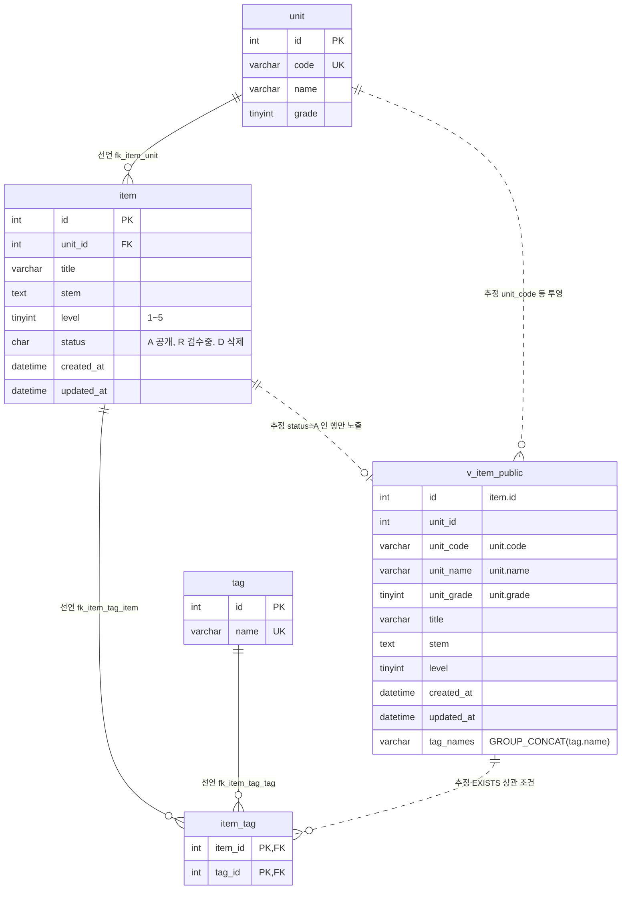
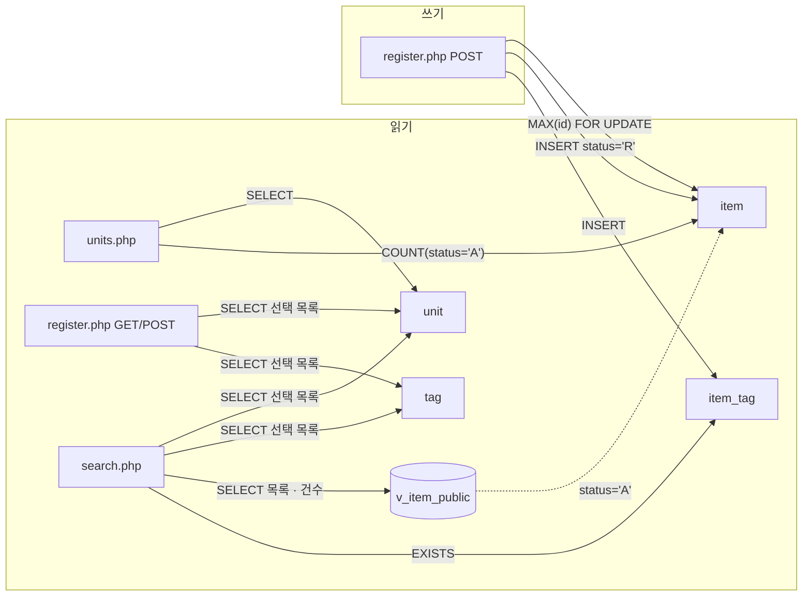

# legacy/item-bank-php 데이터 흐름 (ERD)

> 선행 문서: [ARCHITECTURE.md](ARCHITECTURE.md)
>
> 근거 표기 규칙
> - PHP 파일 경로는 `legacy/item-bank-php/` 기준이다 (예: `search.php:522`).
> - 스키마 파일은 저장소 루트 기준 전체 경로로 쓴다 (예: `db/mariadb/init/01-schema.sql:11`).
>
> ARCHITECTURE.md는 테이블 스키마와 `v_item_public` 정의를 "모듈 안에 정의가 없다"며 미확인으로 남겼다. 모듈 밖의 `db/mariadb/init/01-schema.sql`에서 정의를 찾았다. 이 파일은 `docker-compose.yml:25`에서 MariaDB의 `/docker-entrypoint-initdb.d`로 마운트되고, `item-bank` 서비스는 `docker-compose.yml:35-36`에서 이 모듈로 빌드된다. 접속 DB 이름의 기본값은 `itembank`다 (`inc/db.php:16`, `db/mariadb/init/01-schema.sql:5-6`).

## 1. 테이블 목록

모듈이 접근하는 DB 객체는 테이블 4개와 뷰 1개다. 같은 스키마 파일에 있는 `class`, `assignment`, `distribution`, `submission`은 `assignment-thymeleaf` 모듈용이라 이 모듈의 코드에서는 참조하지 않는다 (`db/mariadb/init/01-schema.sql:72-115`).

| 객체 | 종류 | 주요 컬럼 | 키 · 제약 | 스키마 근거 | 코드 SQL 근거 |
|---|---|---|---|---|---|
| `unit` | 테이블 | `id` INT, `code` VARCHAR(16), `name` VARCHAR(100), `grade` TINYINT | PK `id`, UNIQUE `uk_unit_code(code)` | `db/mariadb/init/01-schema.sql:11-18` | `units.php:16-19`, `register.php:27`, `search.php:125`, `search.php:156` |
| `item` | 테이블 | `id` INT, `unit_id` INT, `title` VARCHAR(200), `stem` TEXT, `level` TINYINT(1~5), `status` CHAR(1) 기본값 `'A'`(A=공개, D=삭제, R=검수중), `created_at` DATETIME, `updated_at` DATETIME | PK `id`, FK `fk_item_unit(unit_id → unit.id)`, 인덱스 `idx_item_unit`, `idx_item_level` | `db/mariadb/init/01-schema.sql:20-33` | `units.php:17`, `register.php:87`, `register.php:93-94` |
| `tag` | 테이블 | `id` INT, `name` VARCHAR(50) | PK `id`, UNIQUE `uk_tag_name(name)` | `db/mariadb/init/01-schema.sql:35-40` | `register.php:34`, `search.php:178`, `search.php:244` |
| `item_tag` | 테이블 (문항 ↔ 태그 연결) | `item_id` INT, `tag_id` INT | 복합 PK `(item_id, tag_id)`, FK `fk_item_tag_item(item_id → item.id)`, FK `fk_item_tag_tag(tag_id → tag.id)` | `db/mariadb/init/01-schema.sql:42-48` | `register.php:105`, `search.php:244-245` |
| `v_item_public` | 뷰 | `id`, `unit_id`, `unit_code`, `unit_name`, `unit_grade`, `title`, `stem`, `level`, `created_at`, `updated_at`, `tag_names`(태그 이름을 `tag.id` 순으로 `,` 연결) | `item JOIN unit`, 조건 `i.status = 'A'` | `db/mariadb/init/01-schema.sql:52-70` | `search.php:521-526` |

### 컬럼별 코드 사용 여부

| 컬럼 | 읽는 곳 | 쓰는 곳 |
|---|---|---|
| `unit.id` | `units.php:16-17`, `register.php:27`(선택 목록 · 단원 검증 `register.php:60-68`) | 없음 |
| `unit.code` | `units.php:16`, `register.php:27`, `search.php:125`(WHERE), `search.php:156` | 없음 |
| `unit.name` | `units.php:16`, `register.php:27`, `search.php:125`, `search.php:156` | 없음 |
| `unit.grade` | `units.php:16`, `units.php:19`(정렬), `register.php:27`(정렬), `search.php:125`, `search.php:156` | 없음 |
| `item.id` | `register.php:87`(`MAX(id)`) | `register.php:93` |
| `item.unit_id` | `units.php:17`(WHERE) | `register.php:93` |
| `item.title`, `item.stem`, `item.level` | 테이블 직접 조회 없음. 뷰로만 읽는다. | `register.php:93` |
| `item.status` | `units.php:17`(`= 'A'`) | `register.php:94`(`'R'` 고정) |
| `item.created_at`, `item.updated_at` | 테이블 직접 조회 없음 | `register.php:94`(`NOW()`, DB 서버 시각) |
| `tag.id` | `register.php:34`(선택 목록 · 태그 검증 `register.php:74-81`), `search.php:244`(JOIN) | 없음 |
| `tag.name` | `register.php:34`, `search.php:178`, `search.php:245`(WHERE) | 없음 |
| `item_tag.item_id`, `item_tag.tag_id` | `search.php:244-245`(EXISTS) | `register.php:105` |
| `v_item_public.id`, `title`, `unit_code`, `level`, `tag_names`, `created_at` | `search.php:521`(SELECT) | 뷰라 쓰지 않음 |
| `v_item_public.title`, `stem` | `search.php:98`(`LIKE` 조건) | 뷰라 쓰지 않음 |
| `v_item_public.unit_code`, `level` | `search.php:118`, `search.php:215`, `search.php:218`, `search.php:226`(WHERE), `search.php:295-325`(ORDER BY) | 뷰라 쓰지 않음 |
| `v_item_public.unit_id`, `unit_name`, `unit_grade`, `updated_at` | 모듈 코드에서 읽지 않음 | 뷰라 쓰지 않음 |

## 2. 테이블 관계

- **선언**: `01-schema.sql`에 `FOREIGN KEY`로 선언된 관계다. 다이어그램에서 실선(`--`)으로 그린다.
- **추정**: 외래 키 선언은 없고 코드의 JOIN이나 상관 조건으로 판단한 관계다. 다이어그램에서 점선(`..`)으로 그린다.

### 관계 근거

| 관계 | 구분 | 근거 | 비고 |
|---|---|---|---|
| `unit` 1 : N `item` (`item.unit_id → unit.id`) | 선언 | `db/mariadb/init/01-schema.sql:32` | 코드에서는 `units.php:17` 상관 서브쿼리 `i.unit_id = u.id`, 뷰 `db/mariadb/init/01-schema.sql:69`에서 JOIN한다. |
| `item` 1 : N `item_tag` (`item_tag.item_id → item.id`) | 선언 | `db/mariadb/init/01-schema.sql:46` | 등록 시 같은 트랜잭션에서 두 테이블에 INSERT한다 (`register.php:85-114`). |
| `tag` 1 : N `item_tag` (`item_tag.tag_id → tag.id`) | 선언 | `db/mariadb/init/01-schema.sql:47` | `search.php:244`, 뷰 `db/mariadb/init/01-schema.sql:66`에서 `t.id = it.tag_id`로 JOIN한다. |
| `item` 1 : 0..1 `v_item_public` | 추정 | 뷰 정의 `db/mariadb/init/01-schema.sql:68-70` | 뷰는 FK를 가질 수 없다. `status = 'A'`인 문항만 한 행씩 나온다. `item`과 `unit`을 INNER JOIN하지만 `fk_item_unit`이 있어 단원이 없는 공개 문항은 생길 수 없다. |
| `unit` 1 : N `v_item_public` | 추정 | 뷰 정의 `db/mariadb/init/01-schema.sql:56-58`, `:69` | 뷰가 `unit`의 `code`, `name`, `grade`를 `unit_code`, `unit_name`, `unit_grade`로 투영한다. |
| `v_item_public` 1 : N `item_tag` (`item_tag.item_id = v_item_public.id`) | 추정 | `search.php:244-245` | 태그 필터의 EXISTS 서브쿼리가 뷰의 `id`와 `item_tag.item_id`를 연결한다. 실제로는 `item.id`를 거친 관계다. |

코드의 JOIN에서 선언된 FK 외의 새로운 테이블 간 관계는 발견되지 않았다.

## 3. 읽기 · 쓰기 위치

`register.php`와 `units.php`에는 함수가 없어 "(최상위)"로 표기한다. `search.php`의 목록 · 건수 SQL은 `buildSearchQuery`가 문자열로 조립하고 `runSearchQuery`가 실행하므로 두 함수를 함께 적는다. 이 모듈에는 `UPDATE`와 `DELETE` 문이 없다 (저장소 전체 검색 결과, `item`, `unit`, `tag`, `item_tag`에 대한 쓰기 SQL은 `register.php:93`, `register.php:105` 두 곳뿐이다).

### `unit`

| 구분 | 파일 | 함수 | SQL · 목적 | 근거 |
|---|---|---|---|---|
| SELECT | `units.php` | (최상위) | 단원 목록과 단원별 공개 문항 수. `grade`, `code` 순 정렬 | `units.php:16-20` |
| SELECT | `register.php` | (최상위) | 등록 폼의 단원 선택 목록. 이 결과로 POST의 `unit_id`를 검증한다 | `register.php:27`, `register.php:60-68` |
| SELECT | `search.php` | `buildSearchQuery` | 입력한 단원 코드의 이름 · 학년 조회 (요약 · 경고 문구용) | `search.php:125-127` |
| SELECT | `search.php` | `buildSearchQuery` | 검색 폼의 단원 선택 목록 | `search.php:156` |
| SELECT (뷰 경유) | `search.php` | `buildSearchQuery` → `runSearchQuery` | `v_item_public`이 내부에서 `unit`을 JOIN | `search.php:522`, `search.php:577`, `search.php:600` |
| INSERT · UPDATE · DELETE | 없음 | - | - | - |

### `item`

| 구분 | 파일 | 함수 | SQL · 목적 | 근거 |
|---|---|---|---|---|
| SELECT | `units.php` | (최상위) | 단원별 `status = 'A'` 문항 수 (상관 서브쿼리) | `units.php:17` |
| SELECT (잠금) | `register.php` | (최상위) | `COALESCE(MAX(id), 0) + 1 ... FOR UPDATE`로 새 문항 번호 채번 | `register.php:87-90` |
| SELECT (뷰 경유) | `search.php` | `buildSearchQuery` → `runSearchQuery` | `v_item_public`이 `status = 'A'` 문항만 읽음 | `search.php:522`, `search.php:577`, `search.php:600` |
| INSERT | `register.php` | (최상위) | 새 문항 저장. `status`는 `'R'`(검수중), `created_at`, `updated_at`은 `NOW()` | `register.php:92-101` |
| UPDATE · DELETE | 없음 | - | - | - |

### `tag`

| 구분 | 파일 | 함수 | SQL · 목적 | 근거 |
|---|---|---|---|---|
| SELECT | `register.php` | (최상위) | 등록 폼의 태그 선택 목록. 이 결과로 POST의 `tags[]`를 걸러낸다 | `register.php:34`, `register.php:74-81` |
| SELECT | `search.php` | `buildSearchQuery` | 검색 폼의 태그 선택 목록 (등록되지 않은 태그 경고에도 사용) | `search.php:178`, `search.php:251-259` |
| SELECT | `search.php` | `buildSearchQuery` → `runSearchQuery` | 태그 필터 EXISTS 서브쿼리에서 `t.name = ?` 비교 | `search.php:244-245`, `search.php:577`, `search.php:600` |
| SELECT (뷰 경유) | `search.php` | `buildSearchQuery` → `runSearchQuery` | `v_item_public.tag_names` 계산 | `db/mariadb/init/01-schema.sql:64-67`, `search.php:521` |
| INSERT · UPDATE · DELETE | 없음 | - | - | - |

### `item_tag`

| 구분 | 파일 | 함수 | SQL · 목적 | 근거 |
|---|---|---|---|---|
| SELECT | `search.php` | `buildSearchQuery` → `runSearchQuery` | 태그 필터 EXISTS 서브쿼리 | `search.php:244-245`, `search.php:577`, `search.php:600` |
| SELECT (뷰 경유) | `search.php` | `buildSearchQuery` → `runSearchQuery` | `v_item_public.tag_names` 계산 | `db/mariadb/init/01-schema.sql:64-67`, `search.php:521` |
| INSERT | `register.php` | (최상위) | 검증된 태그마다 한 행씩 저장. `item` INSERT와 같은 트랜잭션 | `register.php:104-113` |
| UPDATE · DELETE | 없음 | - | - | - |

### `v_item_public` (뷰)

| 구분 | 파일 | 함수 | SQL · 목적 | 근거 |
|---|---|---|---|---|
| SELECT | `search.php` | `buildSearchQuery`(조립) → `runSearchQuery`(실행) | 건수: `SELECT COUNT(*) AS cnt FROM v_item_public WHERE ...` | `search.php:526`, `search.php:577` |
| SELECT | `search.php` | `buildSearchQuery`(조립) → `runSearchQuery`(실행) | 목록: `SELECT id, title, unit_code, level, tag_names, created_at FROM v_item_public WHERE ... ORDER BY ... LIMIT 20 OFFSET n` | `search.php:521-525`, `search.php:600` |

### 화면별 데이터 흐름 요약

- 등록한 문항은 `status = 'R'`로 저장된다 (`register.php:84`, `register.php:94`). 검색은 `status = 'A'`만 거르는 뷰를 쓰므로 (`db/mariadb/init/01-schema.sql:70`), 등록 직후의 문항은 검색 결과와 단원별 문항 수(`units.php:17`)에 나타나지 않는다.
- 이 모듈에는 `R` → `A` 전환(검수 완료)이나 `D`(삭제) 처리를 하는 코드가 없다.

## 4. 미확인 목록

| 항목 | 상태 | 관련 근거 |
|---|---|---|
| 문항 상태를 `R` → `A`, 또는 `D`로 바꾸는 주체 | 미확인. 모듈 안에 `UPDATE` 문이 없고, 저장소의 다른 레거시 · `modern/` 코드에서도 `item`에 대한 `UPDATE` SQL을 찾지 못했다. 운영자의 수동 SQL이나 저장소 밖 도구일 수 있다. | `register.php:84`, `register.php:94` |
| `unit`, `tag` 데이터를 등록 · 수정하는 주체 | 미확인. 모듈 안에 쓰기 코드가 없다. 로컬 환경에서는 시드 스크립트가 넣는다. | `db/mariadb/init/02-seed.sql:9`, `db/mariadb/init/02-seed.sql:19` |
| 스키마 주석의 "등록 화면도 이 뷰를 기준으로 삼는다"는 설명 | 코드와 불일치. `register.php`는 `v_item_public`을 참조하지 않고 `item`, `unit`, `tag`를 직접 조회한다. 주석이 가리키는 다른 등록 화면이 있는지는 미확인이다. | `db/mariadb/init/01-schema.sql:51`, `register.php:27`, `register.php:34`, `register.php:87` |
| 운영 DB 스키마가 `01-schema.sql`과 같은지 | 미확인. 이 문서의 스키마 근거는 로컬 compose 초기화 스크립트다. | `docker-compose.yml:25` |
| `MAX(id)+1 ... FOR UPDATE` 채번이 동시 등록에서 안전한지 | 미확인. 트랜잭션 격리 수준을 코드에서 지정하지 않으므로 DB 설정에 따라 잠금 범위가 달라진다. 번호가 겹치더라도 `item.id`가 PK라 두 번째 INSERT는 실패하고(`db/mariadb/init/01-schema.sql:29`), 롤백 후 "저장 중 오류" 메시지를 보여준다. 데이터 중복은 생기지 않지만 등록 실패는 발생할 수 있다. | `register.php:85-90`, `register.php:99-100`, `register.php:119-122` |
| `created_at`, `updated_at`의 시간대 | 운영 환경은 미확인. DB 서버의 `NOW()`로 기록하고 연결 시 세션 시간대를 지정하지 않으므로 DB 서버 기본 시간대를 따른다. 로컬 compose는 MariaDB에 `TZ: Asia/Seoul`을 준다. | `register.php:94`, `inc/db.php:20-28`, `docker-compose.yml:20` |
| `item.status`에 `A`, `R`, `D` 외의 값이 들어가는지 | 미확인. 스키마에 CHECK 제약이 없고 주석으로만 정의되어 있다. | `db/mariadb/init/01-schema.sql:26` |
| `v_item_public.tag_names`의 `GROUP_CONCAT` 길이 제한(`group_concat_max_len`)에 걸려 잘리는 경우 | 미확인. 서버 설정값을 확인하지 않았다. | `db/mariadb/init/01-schema.sql:64` |
